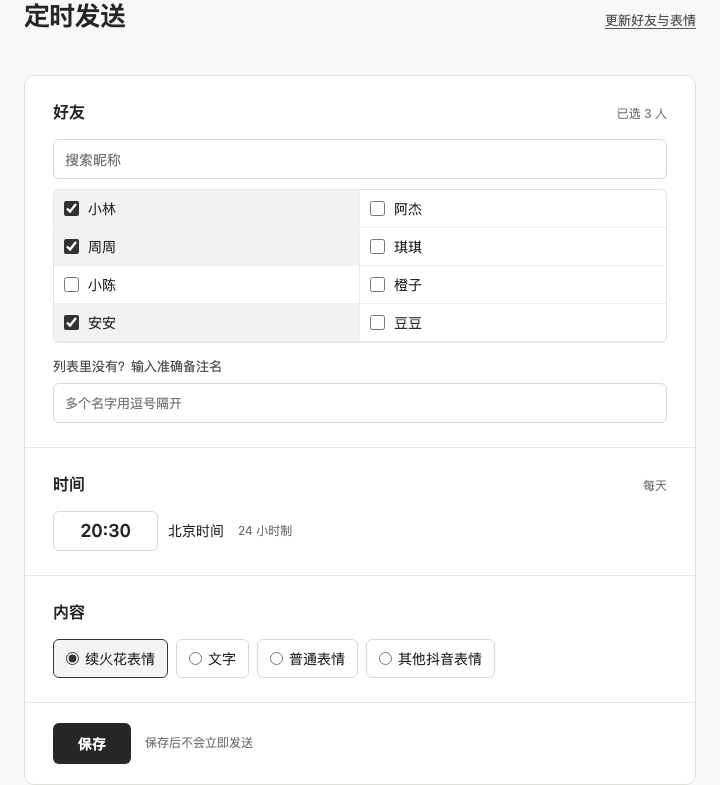

# 抖音火花定时发送

给个人抖音号的好友定时发私信。电脑扫码后选好友、时间和内容，Linux 服务器按北京时间发送。电脑和手机不用一直开着。



可以发送文字、普通表情和抖音聊天里的原生表情，包括“续火花”。好友和表情列表能在设置页刷新；发送结果、登录失效可以通过 ntfy 通知。截图里的昵称是演示数据。

## 在电脑上设置

下面的命令按 macOS / Linux 终端写，电脑需要 Python 3.10 或更新版本。

```bash
git clone https://github.com/sergeymeng/douyin-spark.git
cd douyin-spark
python3 -m venv .venv
.venv/bin/python -m pip install -r requirements.txt
.venv/bin/python -m playwright install chromium
.venv/bin/python setup_web.py
```

设置页和抖音扫码窗口会分别打开。扫码后，在设置页勾选好友，填好每天的发送时间和内容，再点“保存”。时间使用北京时间。好友或表情没显示全，可以点“更新好友与表情”。

保存后先检查一次登录和好友定位。这一步不会发消息：

```bash
.venv/bin/python spark.py --dry-run
```

## 装到服务器

下面按 Ubuntu 22.04 / 24.04 写，服务器需要 systemd、sudo，并且能访问抖音网页。把命令里的 `user@server` 换成自己的 SSH 用户名和地址。

先在服务器装好 Python，下载仓库：

```bash
ssh user@server
sudo apt update
sudo apt install -y git python3 python3-venv python3-pip
git clone https://github.com/sergeymeng/douyin-spark.git ~/douyin-spark
exit
```

回到电脑，把刚才生成的两个文件传过去，再运行安装脚本：

```bash
scp config.json auth.json user@server:~/douyin-spark/
ssh user@server
cd ~/douyin-spark
bash deploy/install.sh
```

安装时会要求给服务器管理页设置密码，账号是 `admin`。脚本会检查登录状态和好友定位，设置每天的发送任务并启动管理页；安装过程不会立即发消息。

查看定时任务：

```bash
systemctl list-timers 'douyin-spark*' --no-pager
```

## 打开管理页

在电脑上另开一个终端，用 SSH 转发服务器上的管理页：

```bash
ssh -L 59177:127.0.0.1:59177 user@server
```

保持连接，打开 <http://127.0.0.1:59177/>。登录后可以改好友、时间、内容，也可以绑定 ntfy 通知。

公网访问、查看日志、重设密码和重新扫码的命令放在 [服务器管理](docs/server.md)。
